# Ledgerly: How Every Feature Works

User guide for every screen and calculation in Ledgerly. Last updated: 2026-11-12.

> **Keep this current.** Any change to a feature, formula or screen that a user would notice must update this guide (and its screenshot, if the screen looks different) in the same commit. See [AGENTS.md §15](../AGENTS.md#15-maintaining-this-file).
>
> Screenshots use a made-up sample account ("Priya Sharma") in a temporary database, taken on 11 Nov 2026. Retake them with the steps in [Updating the screenshots](#updating-the-screenshots).

## Contents

1. [Overview](#1-overview)
2. [Getting started](#2-getting-started)
3. [Recording money](#3-recording-money)
4. [Total Available Balance](#4-total-available-balance)
5. [Overview screen: Income, Spent, Remaining and more](#5-overview-screen-income-spent-remaining-and-more)
6. [Budgets](#6-budgets)
7. [Credit card](#7-credit-card)
8. [Transfers between your own accounts](#8-transfers-between-your-own-accounts)
9. [Loans: lending and borrowing](#9-loans-lending-and-borrowing)
10. [Analytics](#10-analytics)
11. [All Transactions](#11-all-transactions)
12. [Reminders and warnings](#12-reminders-and-warnings)
13. [Gmail auto-capture and To review](#13-gmail-auto-capture-and-to-review)
14. [Exports, privacy and limits](#14-exports-privacy-and-limits)

---

## 1. Overview

Ledgerly is a personal expense tracker in Indian rupees (₹) that keeps two ideas apart: **how much money you have** (Total Available Balance) and **how much you spent** (Spent, budgets, analytics). Every figure is calculated from what you record; there is no sample or estimated data.

The app recognises five kinds of records, and each one affects different numbers:

| You record… | Total Available Balance | Income / Spent / budgets / analytics | Credit card "you owe" |
| --- | --- | --- | --- |
| Expense paid by UPI, cash, debit card or bank | Goes down | Counts as spending | No change |
| Expense paid by **Credit Card** | No change | Counts as spending | Goes up |
| Income | Goes up | Counts as income | No change (a card refund lowers it) |
| Transfer between your own accounts | No change, except to or from the card | Never counted | Bill payment lowers it; cash withdrawal raises it |
| Loan given, taken or repaid | Goes up or down | Never counted | No change |

Only records dated **on or after the moment you entered your balance** move the balance. Older records still count in Spent, budgets and analytics for their month.

**Screens:** Overview (home), Add/Edit transaction, Budgets, Analytics, Loans, Credit Card, Transfer, All Transactions, Your categories, To review, Gmail auto-capture, Login and Sign up. On phones, a bottom bar holds Overview, Analytics, the + button, Budgets and Loans; on wider screens a side bar holds all of them.

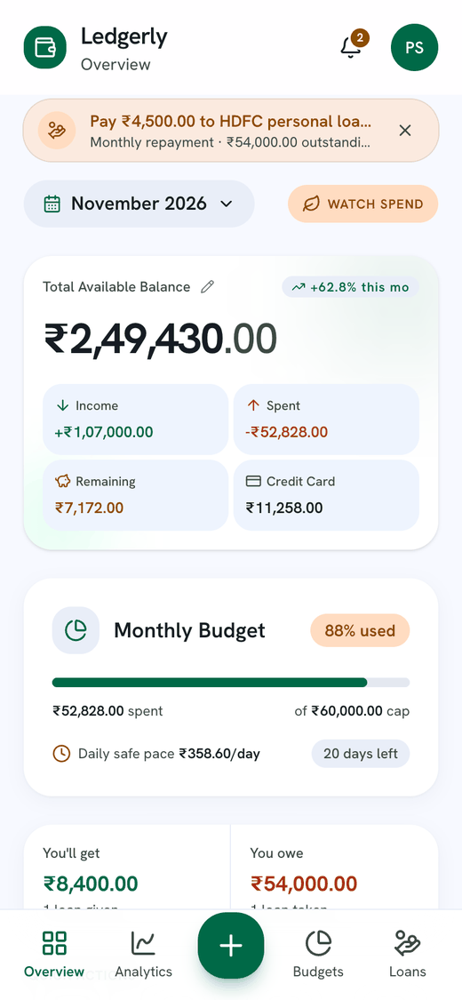

---

## 2. Getting started

Sign up with your name, email and a password; a new account starts completely empty, and only you can see its data.

- **Sign up:** name (1–60 characters), a valid email, password of 8–72 characters. An email can be used for one account only.
- **Log in:** you stay signed in on that device for 30 days. A wrong password and an unknown email give the same message ("Incorrect email or password.") so nobody can find out who has an account.
- **Too many attempts:** after 5 wrong passwords for one email, or 20 attempts from one network, login is paused for up to 15 minutes. Sign-ups are limited to 10 per hour per network.
- **Change password:** account menu (your initials, top right) → Change password. Enter the current password, the new one (at least 8 characters, different from the current) and confirm it. Other devices stay signed in until their 30 days end.
- **Appearance:** account menu → Appearance → **Light** (default), **Dark** or **Device** (follows your phone or computer setting). The choice is saved on that device only.
- **Log out:** account menu → Log out. Your data stays saved on the server.

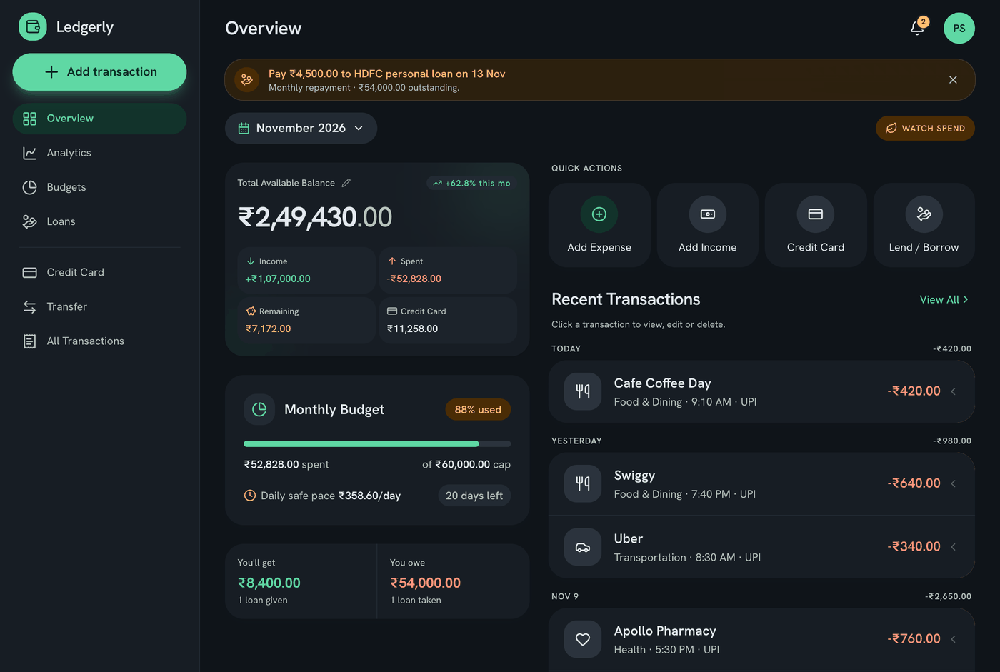

---

## 3. Recording money

Every expense and income is one transaction: an amount, a category, a date and time, a payment method and an optional note. Open it with the **+** button (phone) or **Add transaction** (side bar), or the Add Expense / Add Income quick actions on Overview.

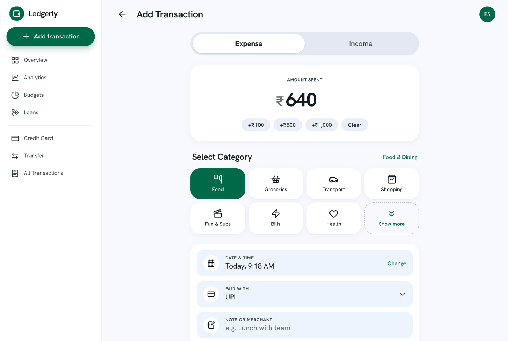

1. **Choose Expense or Income** with the tabs at the top. Expenses are stored as negative amounts and shown in red; income is positive and shown in green.
2. **Enter the amount.** Up to 2 decimals and at most ₹1,000 crore. The chips +₹100, +₹500 and +₹1,000 add to what you typed.
3. **Pick a category** (expenses only). The first tiles are Food, Groceries, Transport, Shopping, Fun & Subs, Bills and Health. **Show more** adds Sending home, Fuel, Sent to friend, Rent, Education, Gifts, Personal care, your own categories and Other.
4. **Set the date and time.** It starts at now. The picker offers Now, Yesterday and 2 days ago, a calendar and a clock; future dates are blocked.
5. **Pick the payment method:** UPI (default), Cash, Debit Card, Credit Card or Bank Transfer. **Credit Card matters:** the expense counts as spending now, but your balance only changes when you pay the card bill (see [Credit card](#7-credit-card)).
6. **Add a note** (merchant or description, up to 120 characters). If left blank, the category name is used.
7. **Save.** A new transaction saves straight away and takes you to Overview.

**Your own categories.** Choosing **Other** shows a "Name this category" box. A name there creates your own category when you save (up to 20 per account, 1–30 characters). If the name matches an existing category, that one is reused. Manage them from the account menu → Your categories: rename (with confirmation) or delete. Deleting moves its expenses to Other and removes its budget, so no total changes.

**Editing and deleting.** Swipe a transaction left, or tap it, to see **View**, **Edit** and **Delete**. Editing asks "Save changes?" and deleting asks for confirmation, because they change existing records.

**Warnings, never blocks.** If an expense is larger than your available balance, an amber note shows under the amount. You can still save, because real life allows overdrafts. Credit card expenses never show this warning.

The receipt field keeps the file's name only; the file itself is not uploaded.

---

## 4. Total Available Balance

The balance is the money you have right now in Bank + UPI + Cash: the amount you typed in, adjusted only by what you record **after** you typed it.

**Entering it.** On a new account, the Overview card asks "How much money do you have right now in your bank, UPI and cash?". It has two fields: the balance (required) and "Unpaid credit card amount right now (billed + unbilled)" (optional; empty means ₹0). Ledgerly stores the value exactly as typed and notes the moment, to the minute. That moment is the **anchor**. Hover over the balance to see when it was set; tap ✎ to re-enter it (this sets a new anchor).

**How it is calculated.** Everything dated on or after the anchor:

```
Balance = entered balance
        + income
        − expenses not paid by credit card
        − card bill payments
        + card cash withdrawals
        + loan cash in − loan cash out
```

| Event (dated after the anchor) | Effect on the balance |
| --- | --- |
| Income | + amount |
| Expense by UPI, Cash, Debit Card or Bank Transfer | − amount |
| Expense by Credit Card | none (it goes to the card's "you owe") |
| Transfer Bank/UPI/Cash → Credit Card (paying the bill) | − amount |
| Transfer Credit Card → Bank/UPI/Cash (cash withdrawal) | + amount |
| Transfer between Bank, UPI and Cash | none |
| You lend money / you receive a repayment | − amount / + amount |
| You borrow money / you repay | + amount / − amount |

**Why the anchor.** The amount you typed already includes everything that happened before. Counting older records again would subtract them twice.

**Worked examples**

- You enter ₹10,000 at 4:30 PM. An expense of ₹500 dated 2:00 PM the same day is ignored: the balance stays ₹10,000, but the ₹500 still counts in Spent for the month.
- Same anchor; a ₹50 expense dated 4:30 PM (same minute) counts: ₹9,950.
- Then ₹1,200 is spent on the credit card: the balance stays ₹9,950. Later you pay the card bill of ₹1,200 from Bank: the balance becomes ₹8,750.

**The "±x% this mo" badge** compares today's balance with where it stood at the start of this month (or at the anchor, if you entered it this month). It is hidden when that starting point is zero or below, or when the change is under 0.05%.

A one-time blue notice appears for older accounts whose balance was entered before the credit card feature existed. It asks you to re-enter the balance with the unpaid card amount, and disappears once you do.

---

## 5. Overview screen: Income, Spent, Remaining and more

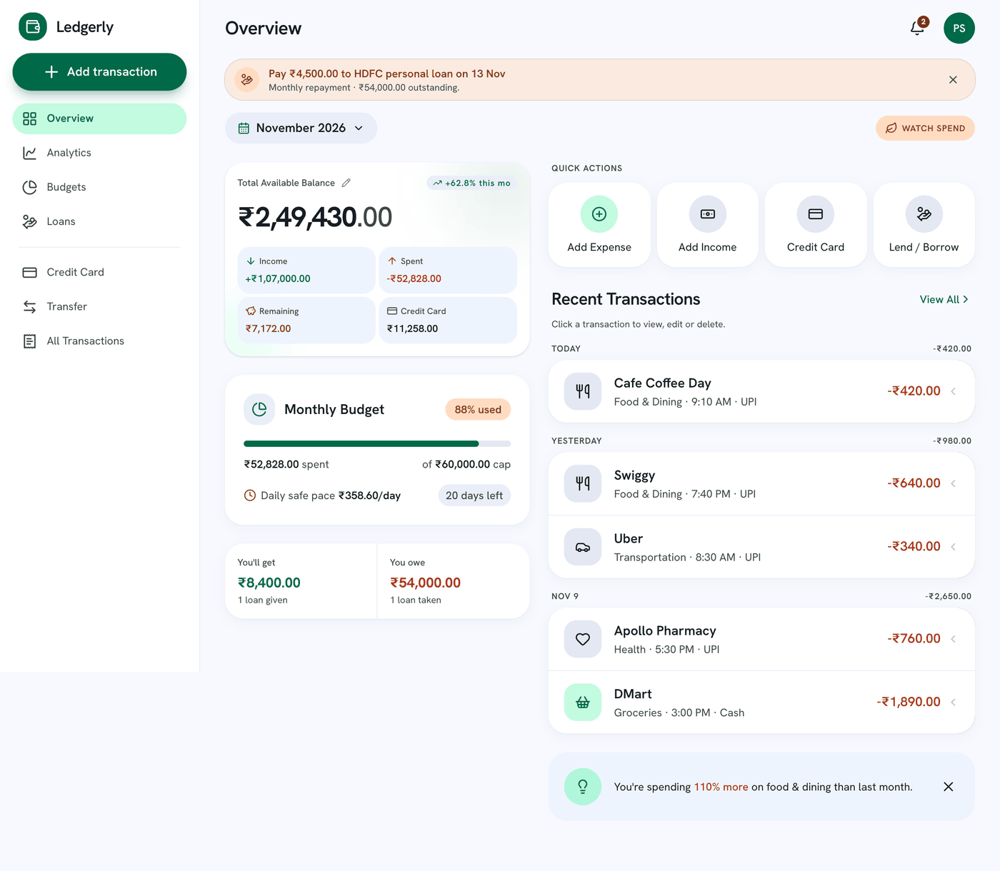

Under the balance, three tiles show **this calendar month** in your local time (1st 00:00 to the next 1st). Unlike the balance, they count every transaction dated in the month, whatever the payment method.

| Tile | What it shows | Notes |
| --- | --- | --- |
| Income | Sum of income this month | Transfers and loans never count |
| Spent | Sum of expenses this month, shown as −₹ | Credit card purchases count here, in the month you bought |
| Remaining | Monthly budget − Spent | "—" when no budget is set; amber when under 30% of the budget is left, red below zero |
| Credit Card | What you owe on the card (or "Card credit" if overpaid) | Only when a card is set up; never subtracted from the balance; tap it for the Credit Card screen |

**Monthly Budget card.** Shows the % used (green below 85%, amber from 85%), a status pill and a bar:

- **On track** below 85% used, **Watch spend** from 85% to 100%, **Over budget** above 100%.
- **Daily safe pace** = what is left ÷ days left in the month, counting today (on 31 October, 1 day is left).
- Example from the product spec: budget ₹3,000, spent ₹1,830.40 → Remaining ₹1,169.60; with 12 days left, the safe pace is ₹97.46 a day.

**Quick actions:** Add Expense, Add Income, Credit Card, Lend / Borrow.

**Recent Transactions:** the latest 5 transactions and transfers together, newest first, grouped as Today, Yesterday or a date. Each group header shows that day's net (income − expenses); transfers don't count in it. Expenses are red, income green and transfers neutral grey. **View All** opens All Transactions.

**Insight tip:** the category with the biggest % change compared with last month (only categories with spending in both months). Hidden if there is none.

**Loans summary:** when any loan is open, "You'll get" and "You owe" totals appear too.

---

## 6. Budgets

A budget is a monthly spending limit: one overall limit plus optional limits per category, all measured against expenses dated in the current month.

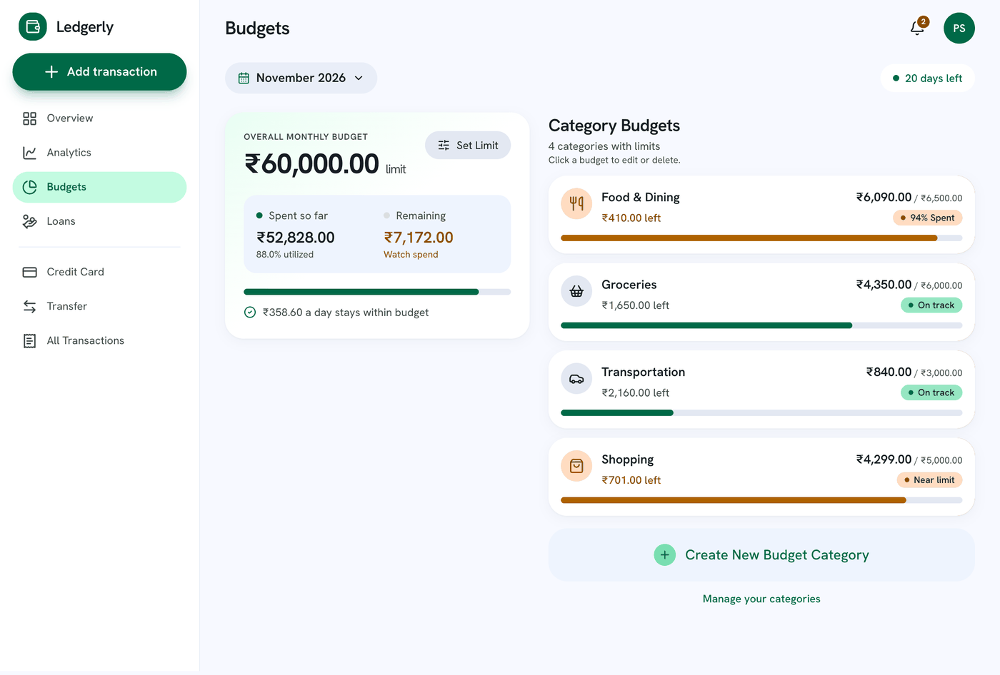

**Monthly limit.** Budgets screen → Set Limit, type the amount, save. ₹0 means no budget. The overall box shows spent / limit, what is left and a status line:

- Same rule as the Overview pill: On track below 85%, Watch spend 85–100%, Over budget above 100%.
- Between 70% and 85% used, the figure is already amber and the line says "N% left" instead of "On track".
- "₹X a day stays within budget" (what is left ÷ days left) shows only while money is left.

**Category budgets.** Pick a category chip (built-in or your own, or **+ New** to create one), enter a limit, save. Each category appears once; Income can't have a budget. Swipe a category card left, or tap it, to **Edit** the limit or **Delete** it (with confirmation).

| Spent / limit | Category badge | Colour |
| --- | --- | --- |
| Below 80% | On track | Green |
| 80% to under 90% | Near limit | Amber |
| 90% to 100% | NN% Spent | Amber |
| Above 100% | Over limit | Amber |

**Information notes (never blocking):**

- When the budget **left** this month is more than your available balance. It compares what is left, not the whole limit, because money already spent has already left the balance.
- When the category budgets add up to more than the monthly budget.

**Worked example.** Monthly limit ₹20,000; Food limit ₹5,000. By the 20th you have spent ₹15,000 in total, ₹4,600 of it on Food. Overall: 75% used, amber figure, "25% left", ₹5,000 left over 11 days (counting the 20th) → ₹454.55 a day. Food: 92% → badge "92% Spent", and the bell shows "Food & Dining budget 92% used".

Credit card purchases count in budgets in the month you buy, not when you pay the bill. Transfers and loans never count.

---

## 7. Credit card

A credit card is money you **owe**, not money you have: card purchases count as spending straight away, but your balance only drops when you pay the bill. Ledgerly supports one card.

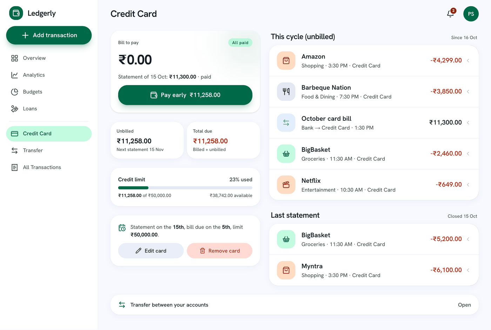

**Setting it up.** Credit Card screen → choose the **statement day** and the **bill due day** (each 1st–28th, and they must differ), and optionally the **credit limit**. Editing or removing the card never changes your balance or your transactions.

**What you owe.** It starts at the unpaid card amount you entered with your balance, then changes with every event after that moment:

| Event | You owe |
| --- | --- |
| Purchase with payment method Credit Card | + amount |
| Refund on the card (income with payment method Credit Card) | − amount |
| Bill payment (transfer Bank/UPI/Cash → Credit Card) | − amount |
| Cash withdrawal (transfer Credit Card → Bank/UPI/Cash) | + amount |

**Statement cycle.** The statement closes at the end of the statement day. Everything owed up to then is the **bill**; anything after it is **unbilled** and moves to the next bill. The due date is the due day of the same month if the due day comes after the statement day, otherwise of the next month.

- **Bill to pay** = the bill − payments made since that statement.
- **Unbilled** = the rest of what you owe.
- **Total due** = bill to pay + unbilled. If you paid too much, it shows **Card credit**.
- **Utilization** = what you owe ÷ credit limit (the bar turns amber at 80%).

**Worked example.** Statement day 15, due day 5, limit ₹50,000. You enter your balance on 1 October with ₹0 unpaid. On 10 October you buy ₹8,000 of groceries by card: Spent rises by ₹8,000, but the balance doesn't move. The statement closes at the end of 15 October, so the bill is ₹8,000, due 5 November. On 20 October you spend ₹2,000 more by card: unbilled ₹2,000, total due ₹10,000, utilization 20%. On 3 November you pay ₹8,000 from Bank: bill to pay ₹0, badge "All paid", and only now does the balance fall by ₹8,000.

**The screen** shows Bill to pay with a badge ("Due 5 Nov · in 2 days": amber within 5 days, red when overdue, green when paid). **Pay bill ₹X** (or **Pay early** when there's no bill yet) opens Transfer prefilled Bank → Credit Card with the amount. Below are the Unbilled and Total due tiles, the limit bar, and lists of this cycle's and the last statement's items.

**Reminders:** "Card bill ₹X due in N days" from 5 days before the due date, "Card bill ₹X overdue" after it, and "Card usage NN% of limit" from 80%.

---

## 8. Transfers between your own accounts

A transfer records money moving between your own accounts (Bank, UPI, Cash, Credit Card). It is never income or spending, so it doesn't appear in Income, Spent, Remaining, budgets, analytics or the Spent/Received totals.

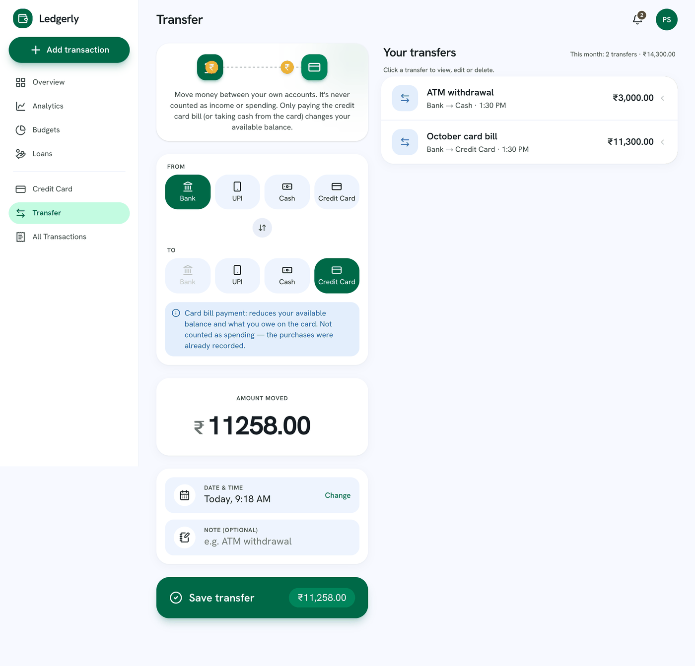

| From → To | Example | Total Available Balance | Credit card "you owe" |
| --- | --- | --- | --- |
| Bank/UPI/Cash → Bank/UPI/Cash | ATM withdrawal (Bank → Cash) | No change | No change |
| Bank/UPI/Cash → Credit Card | Paying the card bill | − amount | − amount |
| Credit Card → Bank/UPI/Cash | Cash advance from the card | + amount | + amount |

**Why paying the bill isn't spending:** the purchases were already recorded as expenses when you made them; counting the payment too would count them twice.

**Using the screen** (from Credit Card → Pay bill, or "Transfer between your accounts"; also in the side bar):

1. Pick **From** and **To** chips; the swap button reverses them. The same account can't be both.
2. Enter the amount, the date and time, and an optional note (up to 120 characters).
3. Save. A new transfer saves at once and the form resets; editing asks "Save changes to this transfer?".

A blue hint explains card bill payments and cash withdrawals. If a bill payment is more than your available balance, an amber warning appears (saving is still allowed). Below the form: "This month: N transfers · ₹X" and your transfer history. Transfers show with a blue ⇄ icon and a neutral amount with no + or −, in Recent Transactions, All Transactions and on this screen.

Ledgerly keeps one total balance; it doesn't track separate Bank, UPI and Cash balances.

---

## 9. Loans: lending and borrowing

Loans track money you lent to or borrowed from friends, relatives, online apps or banks. They move your balance but are never income or spending, so budgets and analytics stay accurate.

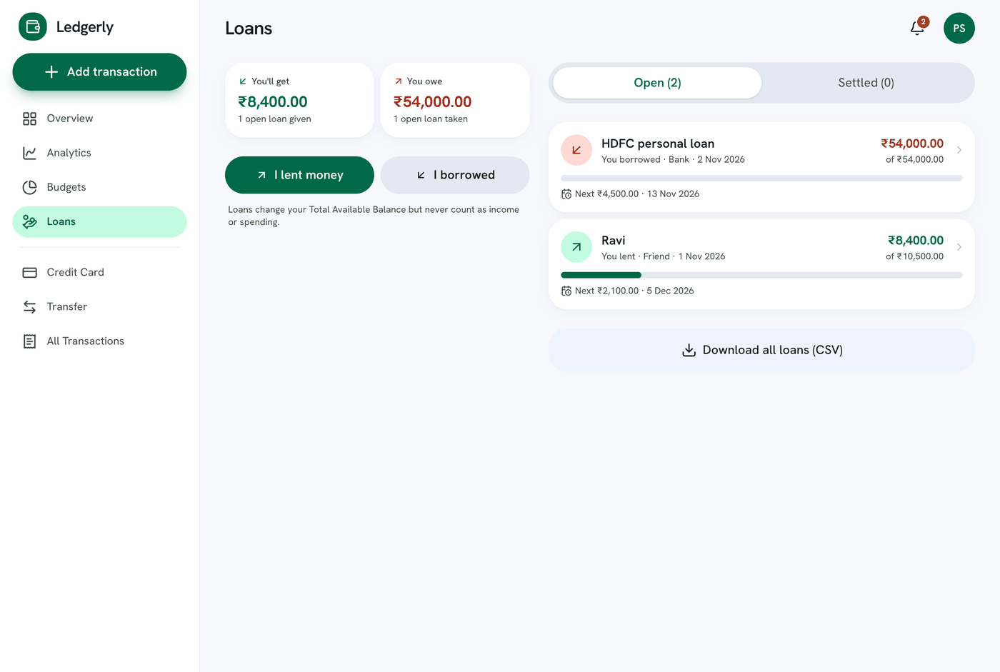

**Creating a loan** (Loans → **I lent money** or **I borrowed**):

- Amount that changed hands, and the person's or lender's name.
- Source: Friend, Relative, Online app, Bank or Other.
- **Total to repay** (optional): use it when interest or fees apply; it must be at least the amount.
- Date, payment method (UPI by default) and an optional note (up to 200 characters).
- **Repay by** date (optional): after it, an unpaid loan is **Overdue**.
- **Monthly repayment plan** (optional): an amount plus a day of the month (1–28).

**Repayments** (open a loan → Record repayment): enter the amount, date and method, or tap a quick chip: **Settle in full · ₹X** or **Monthly · ₹Y**. You can't record more than what's outstanding. Remove a repayment from the history (with confirmation) if you made a mistake.

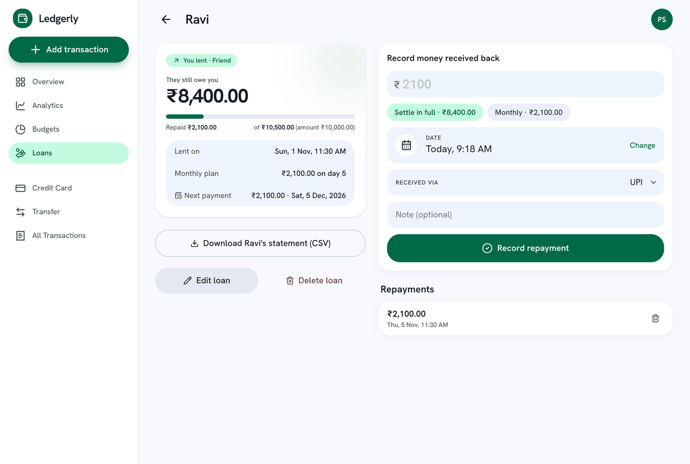

| Figure | Formula |
| --- | --- |
| Paid | Sum of repayments |
| Outstanding | Total to repay − paid (never below 0) |
| Settled | When outstanding reaches ₹0 |
| Progress | Paid ÷ total to repay |
| Next payment | The next plan day on or after today; amount = the smaller of the monthly amount and what's outstanding |
| You'll get | Sum of outstanding on open loans you lent |
| You owe | Sum of outstanding on open loans you borrowed |

**Effect on the balance** (only for loans and repayments dated after your balance anchor):

| Event | Balance |
| --- | --- |
| You lend money | − amount |
| They pay you back | + amount |
| You borrow money | + amount |
| You pay back | − amount |

**Example.** You lend Ravi ₹10,000 on 1 November with Total to repay ₹10,500 and a ₹2,100 monthly plan on the 5th. Your balance falls by ₹10,000; Spent doesn't change. On 5 November Ravi pays ₹2,100: balance +₹2,100, outstanding ₹8,400, progress 20%.

**Lists and exports.** Open loans are sorted overdue first, then by the nearest payment or due date. **Download all loans (CSV)** sits at the end of the Loans tab. On a loan, **Download Ravi's statement (CSV)** covers every loan with that person, like a passbook. The bell reminds you 3 days before a plan payment and when a loan is overdue. Lending, and repaying a loan you borrowed, warn if the amount is more than your balance.

---

## 10. Analytics

Analytics compares your spending and income in the current week, month or year with the previous period of the same length. It uses transactions only: transfers and loans are excluded.

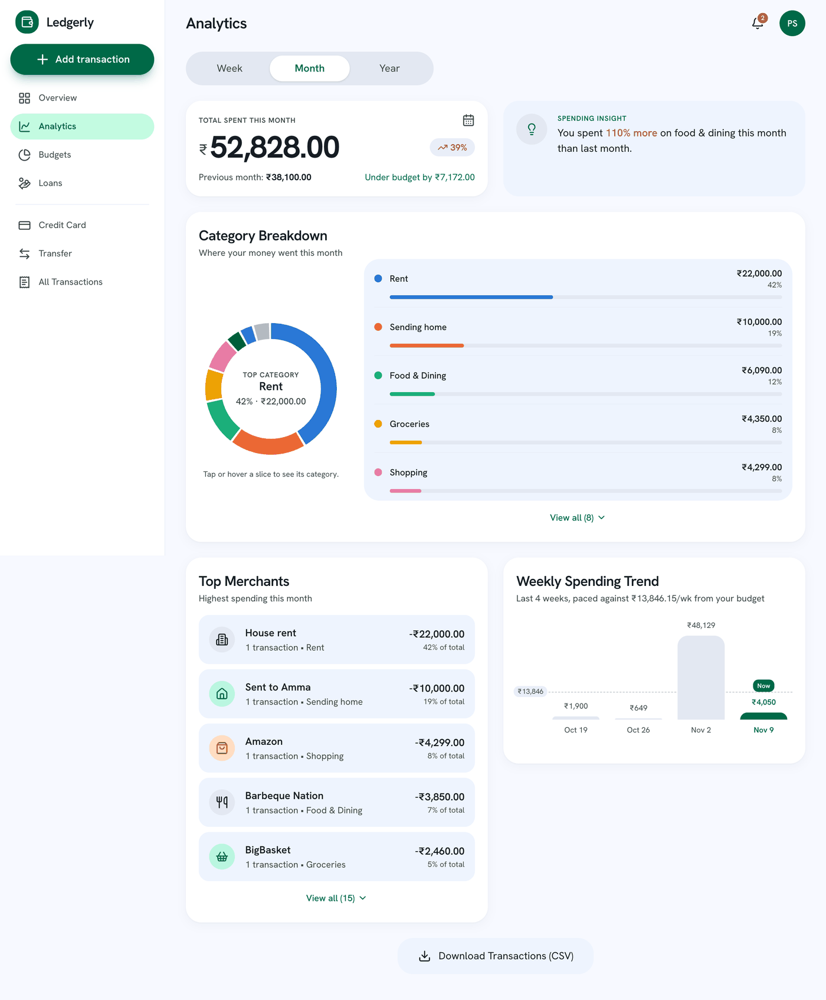

- **Range tabs:** Week (Monday to Sunday), Month or Year. Totals show the % change against the previous period when that period had a value above zero.
- **Budget line:** on Month, with a budget set, "Under budget by ₹X" or "Over budget by ₹X".
- **Category breakdown (donut):** each expense category's share of the period. The 7 largest get their own colour; the rest fold into a grey "More categories (n)" slice, which lists its members. Hover (mouse), tap (touch) or Tab (keyboard) to focus a slice; the others fade, and the centre shows its amount. With nothing focused, the centre shows the top category. Below the ring, one row per slice shows name, amount, % and a bar; lists show 5 rows, then View all.
- **Weekly trend:** spending in each of the last 4 Monday-start weeks. With a budget, a dashed target line shows the weekly equivalent: monthly limit × 12 ÷ 52.
- **Top merchants:** where most money went, by note/merchant.
- **CSV export:** downloads every transaction, newest first, with columns Date, Type, Merchant / note, Category, Payment method, Amount (INR). Dates are DD/MM/YYYY HH:mm; amounts are plain numbers with 2 decimals, expenses negative. The file opens correctly in Excel, including non-English names.

A period with only income shows the empty state instead of a donut.

---

## 11. All Transactions

All Transactions lists every transaction and transfer, 10 per page, with search and filters that combine. Open it with **View All** on Overview or from the side bar.

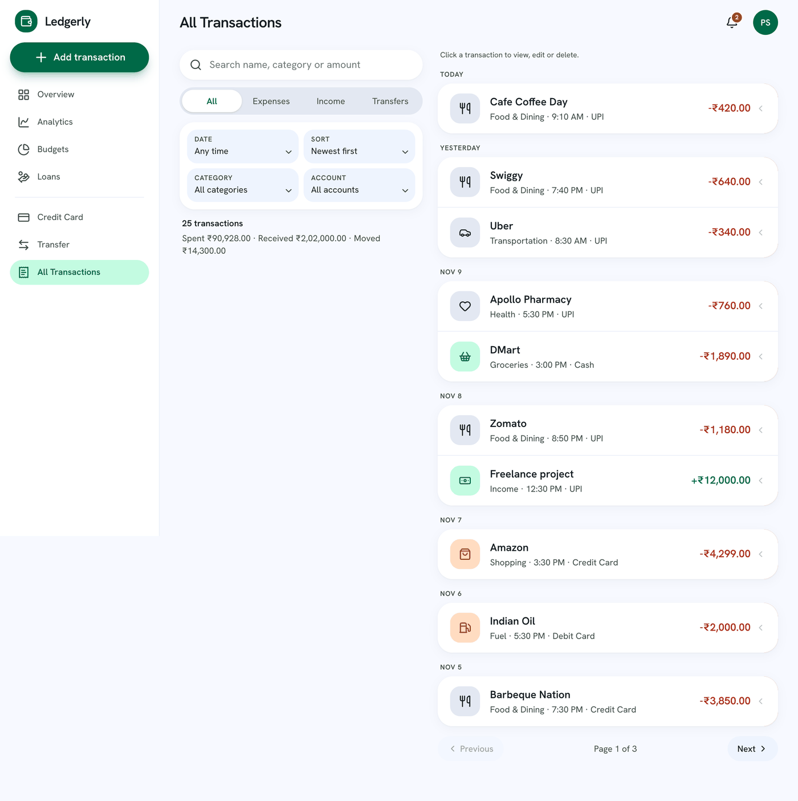

| Control | What it does |
| --- | --- |
| Search | Matches the note/merchant, category, payment method or part of an amount |
| Type tabs | All, Expenses, Income or Transfers |
| Date | This month, Last month, Last 30 days, This year or Custom (a calendar: tap the first day, then the last; both included) |
| Category | Expenses in that category (disabled for Income and Transfers) |
| Account | A payment method, or either side of a transfer |
| Sort | Order of the list |

A summary line shows the count, **Spent** and **Received** (transactions only) and **Moved** (transfers), with **Clear filters**. Changing any filter goes back to page 1. Filters live in the page address, so Back after an edit, or a refresh, keeps your view. On phones, Date, Sort, Category and Account sit behind one Filters button with a badge counting how many are set. Only the latest 1,000 transactions are loaded.

---

## 12. Reminders and warnings

The bell (top right) collects reminders worked out from your data each time you open the app. Its badge counts urgent and warning reminders ("9+" above 9): red if any is urgent, amber otherwise. On Overview, the single most important one also shows as a slim banner under the header.

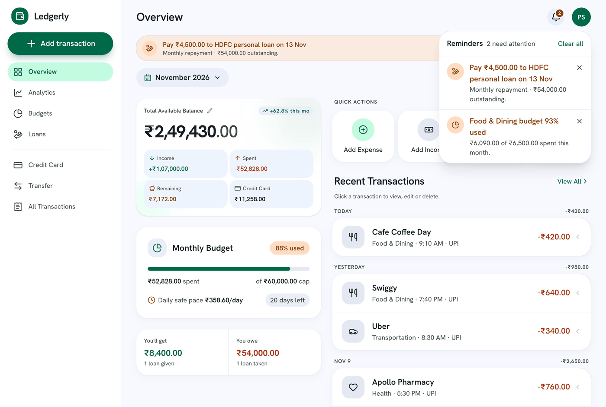

| Reminder | When | Level |
| --- | --- | --- |
| Card bill ₹X overdue | Bill unpaid after the due date | Urgent |
| Card bill ₹X due in N days / tomorrow / today | Bill unpaid, due within 5 days | Warning |
| Card usage NN% of limit | What you owe is at least 80% of the limit | Warning |
| Loan to/from (person) overdue | Open loan past its repay-by date | Urgent |
| Pay ₹X to / Collect ₹X from (person) | Monthly plan payment within 3 days | Warning |
| Monthly budget NN% used | At least 90% of the monthly budget spent | Warning |
| Over monthly budget by ₹X | Above 100% | Urgent |
| (Category) budget NN% used / Over (category) budget by ₹X | Same rules per category budget | Warning / Urgent |
| N bank alerts to review | Gmail alerts waiting (panel only, no badge) | Info |

They are sorted urgent first, then warning, then info, and by date within each. Tap one to open its screen. Tap **×** to remove one, or **Clear all**. Removing is saved to your account, so it stays gone on every device; it only hides the reminder and changes nothing else. A reminder comes back only when something new happens: a new bill, the next stage (due soon → overdue, 90% → over), a new month or a newer bank alert. Reminders are in-app only, with no push or email.

**Low-balance warnings** appear when money going out is more than your available balance: an expense not paid by card, lending money, repaying a borrowed loan, or paying the card bill. They are amber notes under the amount and **never block saving**. Income, repayments you receive and card cash withdrawals never warn. Items dated before your balance anchor don't warn either, because they don't change the balance.

---

## 13. Gmail auto-capture and To review

Auto-capture turns bank alert emails in your Gmail into suggested transactions. Nothing counts anywhere until you review it and tap **Add**.

**Setting it up** (account menu → Gmail auto-capture):

1. Tap **Create my script**. Ledgerly shows a Google Apps Script containing your personal key, once, with a copy button.
2. Follow the numbered steps to paste it into script.google.com in your own Google account and run setup. HDFC's alert address (`alerts@hdfcbank.bank.in`) is already in BANK_SENDERS; for another bank, add or replace it with the address its alerts come from. Running setup again replaces only the script's own 5-minute check.
   - **Check the trigger.** In script.google.com, click **Triggers** (clock icon, left sidebar). You should see `sendBankAlerts`, Time-based, every 5 minutes. If it's missing, click **+ Add Trigger** and choose: function `sendBankAlerts`, deployment Head, event source Time-driven, type Minutes timer, interval Every 5 minutes, then Save. Keep only one `sendBankAlerts` trigger. If you add it this way without running setup, the first run just notes the time, and alerts arriving after that are sent.
3. The script checks Gmail every 5 minutes and sends only bank alerts that arrive after setup. The screen shows when the last alert arrived.
4. **Create a new script** replaces the key (the old script stops working); **Turn off** revokes it. Both ask for confirmation, and alerts already waiting are kept.

**What is captured or ignored.** Only clear money-in or money-out alerts with an amount are kept. OTPs, declined or failed payments, collect requests, upcoming debits and mandates, statement and due reminders and adverts are dropped. The first debit or credit wording decides the direction. The payment method is set to Credit Card, Debit Card, UPI or Bank Transfer; a plain "card" is left blank for you to choose, because credit and debit affect the balance differently. Wording the parser doesn't recognise is dropped (HDFC and common Indian bank wording are covered).

**Privacy.** The script runs in your own Google account; no outside service reads your mail. Account and card numbers, reference numbers and balances are masked as XXXX before anything is stored. Alerts wait at most 30 days.

**Reviewing** (To review, from the Overview row "N transactions to review", the bell or the side bar): each alert is an editable card with Expense / Income / Transfer tabs, amount, merchant, category, payment method (or From/To for a transfer) and date. Card bills arrive as a Bank → Card transfer and ATM withdrawals as Bank → Cash. The category is the one you last used for that merchant; otherwise you pick it. A **possible duplicate** note appears for the same amount and direction within a day. **Add** saves it as a normal transaction or transfer; **Not a transaction** deletes the alert after confirmation.

---

## 14. Exports, privacy and limits

**Exports** are made in your browser from your own data, open in Excel, and use DD/MM/YYYY dates.

| File | Where | Contents |
| --- | --- | --- |
| ledgerly-transactions-YYYY-MM-DD.csv | Analytics | Every transaction: Date, Type, Merchant / note, Category, Payment method, Amount (INR) |
| ledgerly-loans-YYYY-MM-DD.csv | End of the Loans tab | Person, Lent/Borrowed, Date, Total, Repaid, Remaining, Status, then You will get / You owe totals |
| ledgerly-(person)-statement-YYYY-MM-DD.csv | A loan's detail | Passbook of every loan with that person, oldest first, ending with who owes whom |

**Privacy and security**

- Every record belongs to one account; other users can never see or change it (opening another person's item shows "not found").
- Passwords are stored only as secure hashes; the session is a signed cookie that page scripts can't read, valid for 30 days.
- Changes to existing records (edit, delete, rename) always ask for confirmation; new records save directly.

**Limits to know**

- One credit card per account; no EMI, interest or minimum-due maths yet.
- One total balance: Bank, UPI and Cash aren't tracked separately.
- Only the latest 1,000 transactions and 1,000 transfers are loaded.
- Receipts: only the file name is saved.
- No password reset by email yet, and no account deletion screen.
- The month picker on Overview is a placeholder; tiles always show the current month.

**Quick reference**

| Number | Formula |
| --- | --- |
| Total Available Balance | Entered balance + income − non-card expenses − card bill payments + card cash withdrawals ± loan cash, all dated after the anchor |
| Income / Spent | Sum of income / expenses this month (all payment methods) |
| Remaining | Monthly budget − Spent |
| Budget % used | Spent ÷ monthly budget |
| Daily safe pace | Max(0, Remaining) ÷ days left including today |
| Card "you owe" | Unpaid at anchor + card purchases − card refunds − bill payments + cash withdrawals |
| Bill to pay | Owed at last statement − payments since |
| Utilization | You owe ÷ credit limit |
| Loan outstanding | Total to repay − repayments |
| Weekly budget line | Monthly budget × 12 ÷ 52 |

---

## Updating the screenshots

Never take screenshots against the shared database (it holds real users' data), and never run a second Next.js server in the project folder (it breaks a running `npm run dev`; AGENTS.md §17).

1. Copy the repo to a scratch folder (`git ls-files -co --exclude-standard | tar …`, as in AGENTS.md §16) and link `node_modules`.
2. Start a temporary MongoDB (`mongod --dbpath <tmp> --port 27999`) and run `next build` + `next start -p 3128` in the copy with `MONGODB_URI=mongodb://127.0.0.1:27999 MONGODB_DB=test AUTH_SECRET=$(openssl rand -hex 32)`.
3. Sign up a sample user and add sample data through the API (curl with a cookie jar).
4. Capture at 1280 px wide (phone: 390 px), 2× scale, with any headless Chromium (e.g. Playwright), then resize to 1400 px wide (phone 520 px) and reduce to 256 colours, so the folder stays around 1 MB.
5. Replace the file of the same name in `docs/screenshots/`.
